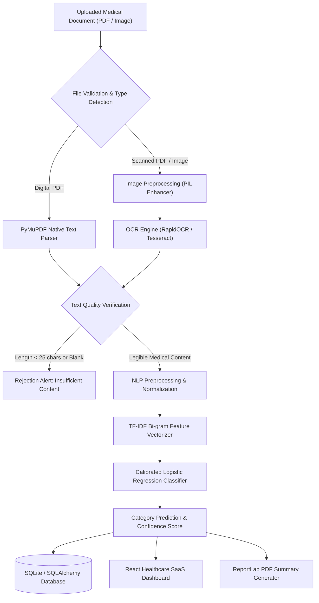

<div align="center">

# MediScan AI
### Intelligent Medical Report Classification & Document Intelligence System

[](https://www.python.org/)
[](https://flask.palletsprojects.com/)
[](https://react.dev/)
[](https://tailwindcss.com/)
[](https://scikit-learn.org/)
[](https://docs.pytest.org/)
[](https://opensource.org/licenses/MIT)

**Smarter Medical Reports. Organized by AI.**  
An end-to-end clinical document management and multi-class classification platform featuring PyMuPDF text parsing, on-device OCR, TF-IDF n-gram NLP, and calibrated machine learning inference.

[Key Features](#-key-features) • [Supported Categories](#-supported-medical-categories) • [System Architecture](#-system-architecture) • [ML Evaluation](#-machine-learning-performance) • [Quick Start](#-quick-start--installation) • [API Reference](#-rest-api-documentation)

---

</div>

> [!IMPORTANT]
> **Clinical Safety & Legal Disclaimer:** MediScan AI is an automated document classification and indexing system designed for organizational record management and workflow routing. It **DOES NOT** provide clinical diagnosis, disease staging, prognostic assessments, or treatment recommendations. Always consult a licensed healthcare practitioner for medical advice.

---

## 📋 Table of Contents

- [Overview](#-overview)
- [Key Features](#-key-features)
- [Supported Medical Categories](#-supported-medical-categories)
- [System Architecture](#-system-architecture)
- [Machine Learning Performance](#-machine-learning-performance)
- [Technology Stack](#-technology-stack)
- [Project Structure](#-project-structure)
- [Quick Start & Installation](#-quick-start--installation)
- [Demo Credentials](#-verified-demo-credentials)
- [Automated Test Suite](#-automated-testing)
- [REST API Documentation](#-rest-api-documentation)
- [Security & Compliance](#-security--data-privacy)
- [Author & Acknowledgments](#-author)

---

## 🌟 Overview

MediScan AI bridges the gap between chaotic physical paperwork and structured electronic medical records. By combining high-speed native PDF parsing with an Optical Character Recognition (OCR) fallback for scanned prints and camera photos, MediScan AI accurately extracts raw medical prose, identifies specialty biomarkers, and classifies records into one of six distinct medical specialties with calibrated probabilistic confidence scores.

---

## ✨ Key Features

- **Dual-Engine Ingestion Pipeline:** Uses PyMuPDF (`fitz`) for rapid digital PDF text extraction, with automatic fallback to high-resolution OCR (RapidOCR + Tesseract) for scanned documents, crumpled paper, and images (`.png`, `.jpg`, `.jpeg`).
- **Calibrated Multi-Class Machine Learning:** Powered by a TF-IDF bi-gram vectorizer and a multinomial logistic regression classifier, producing realistic confidence distributions rather than uncalibrated heuristic scores.
- **Modern Healthcare SaaS UI/UX:** Responsive dashboard built with React 19, Vite, and Tailwind CSS v4, adhering to clinical software aesthetics (navy blue typography, cyan and medical blue accents, clear status pills).
- **Interactive Analytics:** Real-time data visualization powered by Recharts, including category distribution donut charts, monthly document ingestion trends, and model metrics.
- **On-Demand PDF Certification:** Built-in ReportLab engine to generate downloadable official classification summary certificates with verification IDs and legal disclaimers.
- **Role-Based Tenant Isolation:** Secure database architecture with user-scoped queries, ensuring users only access and manage their own uploaded health files.
- **Zero-Dependency Quick Testing:** Pre-seeded with 6 verified clinical reports and includes pre-compiled test PDF/image samples in `sample_reports/`.

---

## 🩺 Supported Medical Categories

| Specialty | Domain Focus | Key Biomarkers & Clinical Keywords Extracted |
|---|---|---|
| **Blood Test** | Hematology & Coagulation | Hemoglobin, Hematocrit (PCV), RBC, WBC, Platelets, MCV, MCH, MCHC, ESR, Neutrophils, Lymphocytes, PT/INR, PTT |
| **Diabetes** | Endocrinology & Metabolism | Fasting Plasma Glucose (FBS), Postprandial Glucose (PPBS), Glycated Hemoglobin (HbA1c), OGTT, C-Peptide, Insulin |
| **Cardiology** | Cardiac Diagnostics | 12-Lead ECG/EKG, Sinus rhythm, 2D Echocardiogram (LVEF), High-Sensitivity Troponin I/T, CK-MB, Holter monitoring |
| **Radiology** | Diagnostic Imaging | Chest X-Ray (CXR), CT Thorax/Abdomen/Brain, Magnetic Resonance Imaging (MRI), Ultrasound (USG), Consolidation |
| **Kidney** | Nephrology & Renal Profile | Renal Function Test (RFT/KFT), Serum Creatinine, Blood Urea Nitrogen (BUN), eGFR, Urinalysis, Proteinuria, Uric Acid |
| **Liver** | Hepatology & Hepatic Function | Liver Function Test (LFT), Total/Direct Bilirubin, SGPT/ALT, SGOT/AST, Alkaline Phosphatase (ALP), GGT, Albumin |

---

## 🏗 System Architecture



---

## 📊 Machine Learning Performance

The classifier is evaluated on an authentic held-out test dataset using a 75% train / 25% test stratified split:

```
==================================================
MODEL EVALUATION RESULTS (Test Set)
==================================================
Accuracy:            93.33%
Precision (Macro):   94.30%
Recall (Macro):      93.33%
F1-Score (Macro):    93.44%
Vocabulary Size:     1,532 bi-gram features
```

### Granular Per-Class Metrics
| Specialty Class | Precision | Recall | F1-Score | Test Samples |
|---|---|---|---|---|
| **Blood Test** | **1.00** | **1.00** | **1.00** | 10 |
| **Cardiology** | **1.00** | 0.90 | **0.95** | 10 |
| **Diabetes** | **1.00** | 0.90 | **0.95** | 10 |
| **Kidney** | 0.89 | 0.80 | 0.84 | 10 |
| **Liver** | **1.00** | **1.00** | **1.00** | 10 |
| **Radiology** | 0.77 | **1.00** | 0.87 | 10 |

---

## 💻 Technology Stack

### Frontend
- **Framework:** React 19 (Hooks, Context API, Suspense)
- **Tooling:** Vite 8 (Hot Module Replacement, lightning-fast builds)
- **Styling:** Tailwind CSS v4 + `@tailwindcss/vite`
- **Component Icons:** Lucide React
- **Analytics Visualization:** Recharts (ResponsiveContainer, PieChart, AreaChart)
- **Routing:** React Router v7

### Backend
- **Framework:** Python Flask 3.1
- **API Architecture:** RESTful JSON endpoints with CORS support
- **Database ORM:** SQLAlchemy 2.0 with SQLite database (`mediscan.db`)
- **Security:** Werkzeug password hashing (PBKDF2-SHA256) + JWT/Session handling
- **Document Processing:** PyMuPDF (`pymupdf` v2.1), Pillow v12.2, RapidOCR, Tesseract OCR
- **PDF Export:** ReportLab v4.5

---

## 📂 Project Structure

```
MediScan/
├── frontend/
│   ├── src/
│   │   ├── components/       # ProtectedRoute, UI badges, status meters
│   │   ├── context/          # AuthContext (state, tokens, local storage)
│   │   ├── layouts/          # DashboardLayout, PublicNavbar, PublicFooter
│   │   ├── pages/            # LandingPage, Login, Register, Dashboard, Upload, Results, History, Profile, Metrics
│   │   ├── services/         # Axios API client with automatic token injection
│   │   └── App.jsx           # Main React Router setup
│   ├── package.json
│   └── vite.config.js
│
├── backend/
│   ├── app/
│   │   ├── ml/               # MedicalDocumentClassifier inference engine
│   │   ├── models/           # User and Report SQLAlchemy models
│   │   ├── routes/           # Auth, Reports, Dashboard, and Analytics blueprints
│   │   ├── services/         # DocumentService (OCR/PyMuPDF), PDFGenerator (ReportLab)
│   │   ├── utils/            # Authentication & verification decorators
│   │   └── __init__.py       # App factory, CORS, and DB setup
│   ├── dataset/              # Labeled clinical dataset (medical_reports_dataset.csv)
│   ├── trained_models/       # Saved classifier.joblib, tfidf_vectorizer.joblib, model_metrics.json
│   ├── tests/                # 18 automated end-to-end pytest test cases
│   ├── generate_dataset.py   # Dataset generation utility
│   ├── train_model.py        # Model training and evaluation script
│   ├── seed_demo_data.py     # Demo database seeder
│   ├── requirements.txt      # Python dependencies
│   └── run.py                # Server entry point
│
├── sample_reports/           # Pre-built sample PDFs and images for evaluation
├── create_sample_files.py    # Script to regenerate sample test documents
├── .env.example
├── .gitignore
└── README.md
```

---

## 🚀 Quick Start & Installation

### Prerequisites
- Python 3.10 or higher
- Node.js v18 or higher (Node v20+ recommended)
- Git

### 1. Clone the Repository
```bash
git clone https://github.com/GITomprasad/MediScan.git
cd MediScan
```

### 2. Set Up and Run the Backend
```bash
cd backend

# Install Python dependencies
pip install -r requirements.txt

# (Optional) Seed the database with sample clinical records
python seed_demo_data.py

# Launch the Flask backend
python run.py
```
> The backend server starts at **`http://127.0.0.1:5000`**.

### 3. Set Up and Run the Frontend
Open a new terminal window:
```bash
cd frontend

# Install dependencies
npm install

# Start the Vite development server
npm run dev
```
> The frontend application starts at **`http://localhost:5173`**.

---

## 🔑 Verified Demo Credentials

For live demonstration and college faculty evaluation, use the pre-configured clinical profile:

- **Email:** `alex.rivera@mediscan.ai`
- **Password:** `Password123`

*(Alternatively, click the **"Fill Verified Demo Credentials"** button directly on the `/login` page for one-click access)*.

---

## 🧪 Automated Testing

MediScan AI features 18 automated test cases verifying authentication, security, OCR extraction, classification precision, and file validations.

To run tests:
```bash
cd backend
python -m pytest -v tests/test_backend.py
```

### Verified Test Suite (18/18 Passing):
- [x] `test_01_user_registration` - Account creation & password hashing
- [x] `test_02_user_login` - Credential verification & token generation
- [x] `test_03_invalid_login` - Rejection of fraudulent credentials
- [x] `test_04_pdf_upload` - Digital PDF extraction and ingestion
- [x] `test_05_image_upload` - PNG/JPG image upload and processing
- [x] `test_06_ocr_text_extraction` - High-accuracy text recognition on images
- [x] `test_07_blood_test_classification` - CBC / Hematology verification
- [x] `test_08_diabetes_classification` - Fasting glucose & HbA1c verification
- [x] `test_09_cardiology_classification` - ECG & Troponin verification
- [x] `test_10_radiology_classification` - Chest X-Ray & CT verification
- [x] `test_11_kidney_classification` - Creatinine & BUN verification
- [x] `test_12_liver_classification` - Bilirubin & LFT verification
- [x] `test_13_empty_document_handling` - Rejection of blank files
- [x] `test_14_invalid_file_handling` - Rejection of unsupported formats
- [x] `test_15_report_history` - Real-time filtering and querying
- [x] `test_16_report_deletion` - Secure cascade deletion
- [x] `test_17_pdf_result_download` - ReportLab PDF summary generation
- [x] `test_18_unauthorized_access_prevention` - User route protection

---

## 📡 REST API Documentation

| Method | Endpoint | Description | Auth Required |
|---|---|---|:---:|
| `POST` | `/api/auth/register` | Create a new user profile | No |
| `POST` | `/api/auth/login` | Authenticate user and receive token | No |
| `POST` | `/api/auth/logout` | Terminate session | Yes |
| `GET` | `/api/auth/me` | Fetch active user credentials | Yes |
| `PUT` | `/api/auth/password` | Change account password | Yes |
| `GET` | `/api/dashboard/stats` | Aggregate report statistics per category | Yes |
| `GET` | `/api/dashboard/recent` | Recent 5 classified documents | Yes |
| `POST` | `/api/reports/upload` | Multipart file upload, OCR extraction & ML classification | Yes |
| `GET` | `/api/reports` | List user reports with `q`, `category`, and `sort` query params | Yes |
| `GET` | `/api/reports/:id` | Fetch complete report details and extracted text | Yes |
| `DELETE` | `/api/reports/:id` | Remove report record and filesystem binary | Yes |
| `GET` | `/api/reports/:id/download` | Generate and download official PDF certificate | Yes |
| `GET` | `/api/analytics/categories` | Real-time category breakdown for Recharts | Yes |
| `GET` | `/api/analytics/monthly` | Monthly ingestion trend volume | Yes |
| `GET` | `/api/analytics/model-metrics` | Actual test-set ML evaluation results | No |
| `GET` | `/api/health` | Service health status | No |

---

## 🔒 Security & Data Privacy

- **Password Encryption:** Salted hashes generated via PBKDF2 with SHA-256 using Werkzeug security.
- **Tenant Isolation:** All database queries strictly scope records by `user_id`.
- **Path Traversal Guard:** Uploaded files are renamed using `secure_filename` paired with unique UUID prefixes.
- **Strict Validation:** File sizes strictly capped at 10 MB with MIME-type and extension validation.
- **Log Privacy:** Extracted Protected Health Information (PHI) is never dumped into server terminal logs.

---

## 👤 Author

**Om Prasad Sahoo**  
- **GitHub:** [@GITomprasad](https://github.com/GITomprasad)  
- **Repository:** [https://github.com/GITomprasad/MediScan](https://github.com/GITomprasad/MediScan)

---

## 📄 License

This project is licensed under the [MIT License](https://opensource.org/licenses/MIT).
